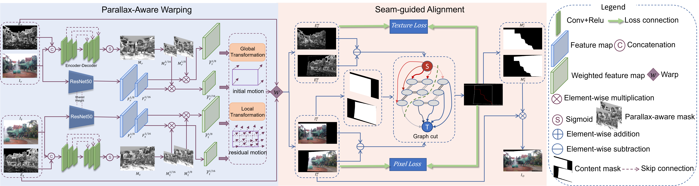

<h1 align="center">Seam-Guided Unsupervised Image Stitching With Parallax-Aware Mask Generation</h1>

<p align="center">
  
</p>

The framework consists of two stages:

1. **Warp:** Unsupervised image warping with parallax-aware mask generation. See [Warp/readme.md](Warp/readme.md) for dataset preparation and training instructions.
2. **Seam_composition:** Seam-guided image composition and test-time optimization. The implementation is available in [Seam_composition/](Seam_composition/).

## Environment Setup

Create and activate the Conda environment from the repository root:

```bash
conda env create -f requirement.yml
conda activate seam
```

## Stage 1: Warp

### Dataset

Download the training dataset (`train.zip`) from [Baidu Netdisk](https://pan.baidu.com/s/1kI0yxoYp89yzWXGN7PdN1g?pwd=q4ff). Extraction code: `q4ff`.

Download **New_dataset** (`testing.zip`) from [Baidu Netdisk](https://pan.baidu.com/s/1135E4umtqJC1iw4JW53jvw?pwd=pa7h). Extraction code: `pa7h`.

Extract the archive and set the training data path to the directory containing the paired `input1/` and `input2/` folders. See [Warp/readme.md](Warp/readme.md) for details.

### Training

```bash
cd Warp
python train.py
```

To use a different dataset location or GPU:

```bash
python train.py --train_path /path/to/training/ --gpu 0
```

### Test on New_datasets

The pre-trained model of Warp (`epoch100_model.pth`) is available at [Baidu Cloud](https://pan.baidu.com/s/1OU5Ihqp5knEtrPh45af7bA?pwd=pay1). Extraction code: `pay1`.

## Stage 2: Seam_composition

This stage performs seam-guided image composition and test-time optimization after image warping. The implementation is available in [Seam_composition/](Seam_composition/).

### Pre-trained Model

Seam_composition uses the same pre-trained Warp model (`epoch100_model.pth`) as Stage 1, available at [Baidu Cloud](https://pan.baidu.com/s/1OU5Ihqp5knEtrPh45af7bA?pwd=pay1). Extraction code: `pay1`.

Place the downloaded model at `/amax/home/taoyz/Seam/Seam_composition/model/epoch100_model.pth`, or update the model path in the test scripts to match your local setup.

## Citation

```bibtex
@article{tao2026seam,
  title={Seam-Guided Unsupervised Image Stitching with Parallax-Aware Mask Generation},
  author={Tao, Yuzhu and Nie, Lang and Chang, Yakun and Li, Bo and Li, Qingwen and Li, Hong and Wei, Shikui},
  journal={IEEE Transactions on Circuits and Systems for Video Technology},
  year={2026},
  publisher={IEEE}
}
```

## Contact

We welcome questions, feedback, and discussions about our work. Please feel free to contact Yuzhu Tao at [taoyuzhu@bjtu.edu.cn](mailto:taoyuzhu@bjtu.edu.cn).

Thank you for your interest in our work!
